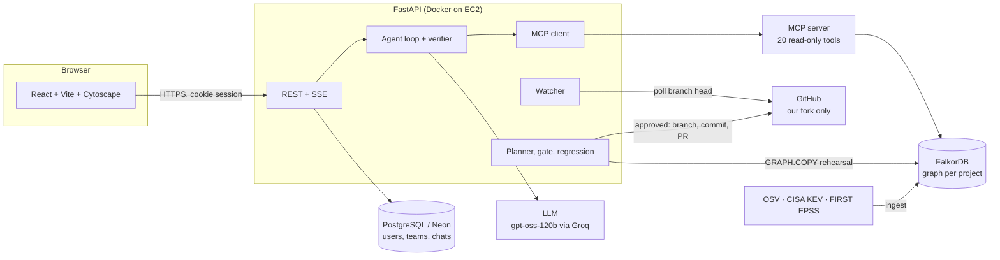
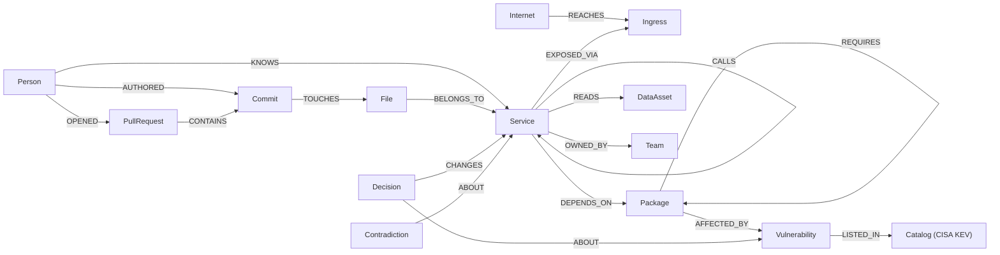

# Warden

**Know which vulnerabilities attackers can really reach, prove it with a path in a graph, and fix it with a change a human approves.**

Built for the WeMakeDevs × FalkorDB **Graph Hacks** hackathon. **Track: Agents That Act on Connected Data.**

| | |
|---|---|
| Repository | https://github.com/ayushKhandelwal07/warden |
| Live demo | _add the Vercel URL here after deploying_ |
| Demo video (2–3 min) | _add the link here_ |
| Demo login | _add a guest login here if the live demo needs one_ |


_(add screenshots: Home attack-surface map, an Ask answer with its evidence path, a fix plan with its gate result, the Evaluation page)_

---

## 1. The problem and what Warden does

A scanner lists hundreds of advisories sorted by severity. It cannot say which ones sit on a path an attacker can walk from the internet, which one carries known exploitation, which data it can reach, or whether a proposed upgrade actually removes the path without opening a new one.

Warden turns a repository and its public vulnerability data into one **FalkorDB graph** of services, calls, ingress, packages, advisories, exploit signals, data assets, owners, people, decisions and history. Then an agent answers questions by **querying that graph**, and every answer shows the path behind it. If there is no path, the agent says so and makes no claim.

For the pinned Online Boutique release (see section 8):

| Question | Number | Unit |
|---|---|---|
| Advisories present | 256 | unique advisories |
| Graph-reachable from the internet-facing service | 239 | unique advisories |
| On the internet-facing service itself | 117 | unique advisories |
| With an exploit signal (CISA KEV or EPSS ≥ 10%) | 3 | unique advisories |
| On CISA KEV (known exploitation reported) | 1 | CVE-2023-44487 |
| Exposures (advisory × service) | 681 | exposure instances |
| KEV exposures | 4 | exposure instances |

These filters overlap; they are not buckets. Every number in the UI can be expanded to the Cypher query that produced it ("Show query").

What the product does, end to end: **find an exposure → inspect the evidence path → build a fix plan → rehearse it on a copy of the graph → pass a deterministic gate → a human approves → pull requests open on a fork → after the merge the graph is re-read and the exposures are checked gone.**

---

## 2. Demo

- **Video:** _link_ (script in [`docs/DEMO_SCRIPT.md`](docs/DEMO_SCRIPT.md))
- **Workflow shown:** Home attack-surface map → the KEV path with per-hop provenance → Ask "what should we fix first?" → Compare fix plans → Build a fix plan (gate + before/after + regression) → Approve → PRs on the fork with a link back to the approval → verification timeline → Evaluation page.
- **Login:** sign up at `/signup`; every new user joins the shared "Google Microservices" project. _(Add the guest login you create for judges.)_

---

## 3. Architecture



| Component | Role |
|---|---|
| **FalkorDB** | The system of record for everything Warden reasons about. Reachability, ranking, rehearsal, regression, memory and history are Cypher over it. One graph per project (`org_demo`, `proj_<id>`), plus `agents_*` for approvals and watcher state, `*_golden` for the pinned snapshot, and short-lived copies (`*_rehearsal_*`, `*_whatif_*`, `eval_*`). |
| **FastAPI backend** | REST + server-sent events, sessions (httpOnly cookie), the agent loop, planner, gate, watcher, evaluation. |
| **MCP server** (`warden.mcp_server`) | The same 20 tools the UI's Tools page runs, served over stdio or HTTP so any MCP client can use them. The agent calls them through an MCP session. |
| **PostgreSQL (Neon in production)** | Users, teams, projects, saved chats, tool runs. Not used for any security fact. |
| **LLM** (`openai/gpt-oss-120b` on Groq, any OpenAI-compatible endpoint) | Chooses tools and writes a short answer from their results. It never sees data except through tools. |
| **GitHub** | Read: repository, PRs, issues, people. Write (only after human approval, only on the configured fork): branches, commits, PRs, comments, labels. |
| **React frontend** | Home, Ask, PR impact, Approvals, Tools, Sync, Evaluation, Settings. Graphs are drawn with Cytoscape from evidence returned by the API. |

**Data flow of one answer.** The browser posts a question → the agent sends it to the LLM with the tool list → the LLM calls tools → each tool runs read-only Cypher through `GRAPH.RO_QUERY` and returns rows, an evidence path and its queries → the LLM writes ≤ 110 words → a deterministic verifier checks that every service and CVE named appears in a tool result → the UI shows the answer, the path, the per-hop provenance and the Cypher.

---

## 4. The graph (FalkorDB)

### Schema



Counts below are from the live graph (it follows the fork, so they shift slightly if the fork changes).

| Node label | Count | Key properties |
|---|---|---|
| `Service` | 12 | `name`, `language`, `tier`, `path_prefix`, `description`, `source_url` |
| `Package` | 434 | `key` (`ecosystem:name@version`), `name`, `version`, `ecosystem` |
| `Vulnerability` | 256 | `id`, `severity`, `cvss`, `kev`, `epss`, `epss_percentile`, `aliases`, `summary`, `url` |
| `Catalog` | 1 | CISA KEV: `catalog_version`, `released`, `entries` |
| `Ingress`, `Internet` | 2, 1 | `kind` (LoadBalancer), `source_url` |
| `DataAsset` | 5 | `name`, `sensitivity` (PCI, PII, …), `weight` |
| `Team`, `Policy`, `Incident` | 6, 4, 4 | curated (synthetic), see section 8 |
| `Person`, `Commit`, `File`, `PullRequest` | 27, 799, 303, 791 | from real git history |
| `Decision`, `Contradiction`, `TimelineEvent`, `IngestRun` | | written by Warden: approvals/rejections, source conflicts, history, provenance |

| Relationship | Count | Meaning |
|---|---|---|
| `CALLS` | 16 | service → service, **inferred** from `*_ADDR` environment variables in the manifests |
| `DEPENDS_ON` | 854 | service → package, from lockfiles / go.mod / csproj / requirements / Dockerfile (`direct` flag) |
| `REQUIRES` | 633 | package → package (transitive chain) |
| `AFFECTED_BY` | 324 | package → advisory, from OSV, with `fixed` version |
| `LISTED_IN` | 1 | advisory → CISA KEV catalog entry |
| `EXPOSED_VIA`, `REACHES` | 2, 2 | Kubernetes LoadBalancer → ingress → internet |
| `READS` | 10 | service → sensitive data (curated) |
| `KNOWS`, `AUTHORED`, `TOUCHES`, `OPENED`, `CONTAINS`, `BELONGS_TO`, `OWNED_BY` | | people, history and ownership |

Every structural edge is stamped with the ingest run and a source (`manifest`, `lockfile`, `osv`, `kev`, `git`, or `curated`); the UI shows each hop as **sourced**, **inferred** or **curated**.

### How exposure and reachability are computed

An advisory is **graph-reachable** when its package is installed in a service that the internet-facing service can reach over at most 4 `CALLS` hops:

```cypher
MATCH (:Ingress)<-[:EXPOSED_VIA]-(entry:Service)
MATCH p = (entry)-[:CALLS*0..4]->(s:Service)
WITH s, min(length(p)) AS hops
MATCH (s)-[d:DEPENDS_ON]->(pkg:Package)-[a:AFFECTED_BY]->(v:Vulnerability)
OPTIONAL MATCH (s)-[:READS]->(da:DataAsset)
RETURN v.id, v.severity, v.cvss, v.kev, v.epss, s.name, hops, pkg.key, a.fixed, max(da.weight) AS data_weight
```

The path for one finding (this is what the evidence graph draws):

```cypher
MATCH p = (:Internet)-[:REACHES]->(:Ingress)<-[:EXPOSED_VIA]-(:Service)-[:CALLS*0..4]->(s:Service {name: $service})
      -[:DEPENDS_ON]->(:Package {key: $package_key})-[:AFFECTED_BY]->(v:Vulnerability {id: $vuln})
RETURN p ORDER BY length(p) LIMIT 1
```

Internet-to-sensitive-data routes (used by choke points and the attack-surface map):

```cypher
MATCH p = (:Ingress)<-[:EXPOSED_VIA]-(e:Service)-[:CALLS*0..4]->(s:Service)-[:READS]->(d:DataAsset)
WHERE d.weight >= 3
RETURN [n IN nodes(p) WHERE n:Service | n.name] AS route, d.name AS asset
```

**Techniques used:** variable-length traversal with hop counting; `GRAPH.RO_QUERY` for every answer; `GRAPH.COPY` to rehearse a fix, a what-if or an evaluation scenario on a copy and delete it; `algo.SPpaths` (all-pairs paths over `CALLS`) for exact betweenness; `algo.pageRank` over `REQUIRES` for load-bearing packages; path enumeration for choke points ("secure X" = cut every route through X).

### A real path, hop by hop

`Internet → frontend-external → frontend → golang.org/x/net@0.10.0 → CVE-2023-44487 → CISA KEV`

| Hop | Relationship | Source |
|---|---|---|
| Internet → `frontend-external` | `REACHES` | Kubernetes Service of type LoadBalancer (sourced) |
| `frontend` → `frontend-external` | `EXPOSED_VIA` | the manifest says the service is behind the public load balancer (sourced) |
| `frontend` → `golang.org/x/net@0.10.0` | `DEPENDS_ON` | direct dependency in `src/frontend/go.mod` (sourced) |
| package → `CVE-2023-44487` | `AFFECTED_BY` | OSV advisory; fixed in 0.17.0 (sourced) |
| advisory → CISA KEV | `LISTED_IN` | KEV catalog entry, added 2023-10-10 (sourced) |

This one has 0 `CALLS` hops, so it contains no inferred edge. Deeper paths such as `frontend → checkoutservice → paymentservice` use `CALLS` edges derived from environment variables, and the UI marks them **inferred**.

---

## 5. The AI agent and its safety

**What the LLM does.** It picks tools and writes a short answer from their results (system prompt in `backend/warden/agent.py`). It has no other source of facts.

**Tools (20, all read-only except where noted).** The same registry is served on the Tools page, over MCP, and to the agent.

| Group | Tools |
|---|---|
| Security | `reachable_findings`, `exploit_intel`, `fix_path` |
| Topology | `blast_radius`, `path_between`, `rank` (betweenness, PageRank), `choke_points` |
| People | `who_owns`, `who_knows`, `person_profile` |
| Changes & policy | `pr_touched_services`, `past_incidents`, `policies_for` |
| Memory | `decisions_about`, `exposure_timeline`, `contradictions_for` |
| Repo and graph | `graph_schema`, `graph_query` (any read-only Cypher), `repo_info` (the fork on GitHub, read only) |
| Search | `find_entity` |

Two local tools rehearse on copies and write nothing real (`what_if`, `compare_plans`); two create **pending** approvals only (`propose_fix_plan`, `analyze_pr`).

**"No path, no claim."** After the model answers, a deterministic verifier checks that every service and CVE it names appears in a tool result of that turn, that it does not call something "exploitable" unless a result shows an exploit signal, and that claims about decisions, incidents or owners had the matching tool called. If not, the answer is sent back once, then shown as **Unverified**.

**Risk score** (per advisory × service exposure; `backend/warden/tools/risk.py`):

```
risk = 50 × severity × exploit × exposure × data
severity  CVSS / 10 (or a label default when there is no score)
exploit   1.0 if on CISA KEV, else 0.1 + 0.9 × EPSS
exposure  0.5 ^ hops from the internet-facing service
data      1 + (max weight of data the service reads) / 5      (1.0 to 2.0)
```

Assumptions: reachability is structural, a CISA KEV listing means exploitation was reported somewhere (not here), EPSS is a probability estimate. A finding is in tier `exploit_signal` when it is on KEV or EPSS ≥ 10%, otherwise `exposed`.

**Fix plans and the gate.** The planner picks the fewest upgrades that remove the most risk (KEV first), then **rehearses them on a `GRAPH.COPY` of the live graph**: swaps the package versions, loads the *new* versions' advisories from OSV, and re-runs reachability. A deterministic gate (no LLM) checks:

1. no open evidence contradiction on what the plan touches
2. total risk drops
3. KEV exposures are eliminated or reduced
4. no new critical or KEV exposure
5. no new high-severity or exploit-signal exposure of PCI/PII data
6. no service newly exposed to a vulnerability

plus warnings (new lower-severity PCI/PII exposure, major-version bumps, residual KEV) and the highest remaining exposures. A plan that fails a blocking check is never filed. **Try an unsafe plan** on Home pins `golang.org/x/net` back to `v0.9.0` and shows the gate blocking it.

**Attack-path regression.** Before the rehearsal Warden records the invariant paths (KEV exposures, exposures reaching PCI/PII, services that still reach sensitive data) by stable semantic id (advisory × service), then classifies each as removed / remaining / new after.

**Human approval.** Nothing external happens until a person approves in the Approvals screen. Approving opens one pull request per service on the configured fork; the code refuses to write to the upstream owner. PR comments and bodies link back to the approval page.

**Verification.** After a merge the watcher (or Sync) re-reads the fork into the graph and looks up the exact (advisory, service) exposures the approval promised to remove. The approval's timeline shows proposed → approved → PRs → checks → merged → graph re-read → exposures gone, with a verdict of verified fixed / partially fixed / not fixed.

**Decision memory.** A rejection with a reason removes that upgrade from later plans and is cited in the plan. An approval is reused only while the package versions and the ingested commit are unchanged; otherwise it is marked stale and the plan is re-gated.

**What the agent cannot reliably determine.** Whether a vulnerable function is actually called (no function-level analysis); real runtime traffic (CALLS are inferred from manifests); whether an upgrade breaks behaviour (the gate checks exposure, not tests, and lockfiles are not regenerated: CI must run `go mod tidy` / `npm install`); anything the graph does not contain.

---

## 6. Setup

### Prerequisites

| | Version |
|---|---|
| Docker + Compose | recent (FalkorDB and Postgres run in containers) |
| Python | 3.11 |
| Node.js | 20+ (frontend uses Vite 8 / React 19) |
| Git | any recent |
| LLM key | any OpenAI-compatible endpoint (we used Groq, free tier) |
| GitHub | a **fork** of the Online Boutique repo and a fine-grained token (optional: without it, plans stop at the approval and nothing is written) |

### Install and run

```bash
git clone https://github.com/ayushKhandelwal07/warden.git
cd warden
cp .env.example .env        # then edit it, see the table below
```

One command (creates the venv, installs dependencies, starts FalkorDB and Postgres, builds the graph the first time, starts API and UI):

```powershell
.\start.ps1                 # Windows PowerShell
```
```bash
./start.sh                  # macOS / Linux / Git Bash
```

Open http://localhost:5173. API on :8000, FalkorDB on :6380 (graph) and :3000 (FalkorDB Browser), Postgres on :5433.

Manual start, if you prefer:

```bash
docker compose up -d falkordb postgres
cd backend && python -m venv .venv && .venv/Scripts/pip install -r requirements.txt   # use .venv/bin on Linux/macOS
.venv/Scripts/python -m warden.ingest --snapshot      # clone the repo, build the graph, save the pinned snapshot (first run, a few minutes)
.venv/Scripts/uvicorn warden.api.app:app --port 8000
cd ../frontend && npm install && npm run dev
```

### Load or reset the data

- First start builds the graph from the pinned release and saves a snapshot (`org_demo_golden`).
- **`python -m warden.prepare`** from `backend/` (or `.\start.ps1 -Reset`, or Sync → Reset to the pinned release in the UI) switches the watcher off, reverts the fork's demo change, restores the pinned snapshot, clears approvals and watcher state, and runs the evaluation once.
- There is no seeded sample history: approvals, decisions and the timeline only contain what you actually did.

### Environment variables (`.env.example`)

| Variable | Purpose |
|---|---|
| `FALKORDB_HOST/PORT/USERNAME/PASSWORD/SSL` | FalkorDB (local container, a server, or FalkorDB Cloud with `FALKORDB_SSL=true`) |
| `DATABASE_URL` | PostgreSQL (local container or Neon) |
| `SESSION_SECRET` | signs session tokens: set a long random value outside local dev |
| `LLM_BASE_URL`, `LLM_API_KEY`, `LLM_MODEL` | the agent's model |
| `DEMO_REPO_URL`, `DEMO_REF`, `HISTORY_SINCE` | the repository the graph is built from and its pinned release |
| `GITHUB_TOKEN`, `GITHUB_OWNER`, `GITHUB_REPO`, `GITHUB_BASE` | the fork Warden acts on and the branch PRs target |
| `WARDEN_URL` | public UI URL, used for links in PR comments |
| `CORS_ORIGINS`, `COOKIE_SAMESITE`, `COOKIE_SECURE` | for UI and API on different origins |
| `WATCH_INTERVAL` | watcher poll seconds (default 30) |

### Configure the GitHub fork

1. Fork `GoogleCloudPlatform/microservices-demo` to your account.
2. On the fork create the branch Warden targets from the pinned tag: `git branch demo-base v0.8.0 && git push origin demo-base`.
3. Create a fine-grained token limited to the fork: **Contents, Pull requests, Issues: read and write**.
4. Set `GITHUB_TOKEN`, `GITHUB_OWNER` (your username), `GITHUB_REPO`, `GITHUB_BASE` in `.env` and restart the API.

### Tests and build

```bash
cd backend && .venv/Scripts/python -m pytest -q          # needs FalkorDB and Postgres running
cd frontend && npx tsc -b && npm run build
```

Latest run: **111 passed, 6 skipped.** The 6 skipped tests assert the exact numbers of the pinned release and skip themselves when the graph follows a changed fork; reset to the pinned release to run them.

### Deploy

See [`DEPLOY.md`](DEPLOY.md): API on EC2 with Docker Compose and Caddy (HTTPS), UI on Vercel with `VITE_API_URL`.

### Troubleshooting

| Symptom | Fix |
|---|---|
| "Can't reach the Warden API" in the UI | start the API; check `http://localhost:8000/api/health` |
| Health says graph offline | `docker compose up -d falkordb`; check `FALKORDB_PORT` (default 6380) |
| Empty graph | run `python -m warden.ingest --snapshot` from `backend` |
| Port 5433 or 6380 already in use | change the host ports in `docker-compose.yml` and `.env` |
| API does not pick up code changes on Windows | stop and start it; `--reload` can hang |
| Ask answers "no tools" or errors | check `LLM_API_KEY` and `LLM_BASE_URL`; free tiers rate-limit, the agent retries |
| Approve does nothing real | GitHub is not configured: the approval is recorded as "approved, not executed" |
| Numbers differ from this README | the graph follows the fork; Sync → Reset to the pinned release |

---

## 7. Evaluation and results

**13 designed scenarios** run on small throwaway graphs (`eval_<id>`) built in the real schema, through the real tools, planner chooser and gate, then deleted. Each has a known answer written from how the scenario is built. Run them on the **Evaluation** page, `POST /api/eval/run`, or `python -c "from warden.eval import run; print(run())"`.

| Category | Scenarios |
|---|---|
| Reachability (4) | reachable direct dependency · unreachable service · advisory one hop behind the entry · entry to card data in two hops |
| Fix gate (3) | safe fix · fix that introduces a different KEV · fix that exposes card data to a new HIGH advisory |
| Abstain (2) | no fixed version published · go.mod and Dockerfile disagree on the Go version |
| Priority order (2) | nearly equal CVSS but different exposure · KEV MEDIUM vs a CRITICAL with no exploit signal |
| Choke point (1), Decision memory (1) | one service on most paths to sensitive data · an approval goes stale after a re-read from another commit |

**Latest results** (Evaluation page, one run): **13 of 13 match their known answer.** Reachability precision 100% and recall 100% (severity-only baseline: precision 75%, recall 100%); priority order 2 of 2 (baseline 0 of 2); gate 3 of 3; abstain 2 of 2; choke point 1 of 1; decision memory 1 of 1. Graph query latency over 18 queries: p50 4.5 ms, p95 6.4 ms. The run takes under a second.

**Metric definitions.** Precision = reachable findings returned that are in the scenario's truth set ÷ findings returned; recall = truth findings returned ÷ truth findings. "Priority order correct" = the top-ranked exposure equals the known answer. Latency = the `ms` Warden records for each Cypher query the tools ran.

**Baseline.** The "severity-only scanner" ranks every present advisory by CVSS (ties by advisory id), has no reachability, no gate and never abstains. Where it cannot take part (gate, abstain, choke point, memory) the page says **not supported**, not "failed".

**Real-data comparison (not a test).** On the 681 exposures of the pinned release, Warden's top 10 shares **0 of 10** with the CVSS-only top 10, and the 4 KEV exposures sit at CVSS ranks 195–198 but graph ranks 1–7. A KEV-first scanner (the stronger baseline) shares 4 of 10. Both rankings use the same exposures and the same snapshot, and neither is tuned to the other (`GET /api/baseline`). The numbers change if the graph follows a changed fork.

**Designed tests are not independent benchmarks.** They show the code behaves as designed on controlled topologies. They do not measure accuracy on other repositories or against real attackers.

**Known limitations and unsupported cases:** no function-level reachability; `CALLS` edges are inferred; only repositories with the same layout (Kubernetes manifests + one folder per service) are supported; EPSS and KEV are point-in-time; major-version upgrades are flagged, not tested; the gate does not run the project's tests (local pre-flight runs `go` and `npm` only if installed, otherwise it reports the step as skipped).

---

## 8. Data and limitations

- **Repository:** Google's **Online Boutique** microservices demo (`GoogleCloudPlatform/microservices-demo`, Apache-2.0), pinned at **v0.8.0**: 12 services in Go, C#, Node.js, Python and Java. Warden acts on our fork `ayushKhandelwal07/microservices-demo`, never upstream.
- **External data:** **OSV** (advisories and fixed versions, matched per package version), **CISA KEV** (known exploitation reported), **FIRST EPSS** (30-day exploit probability), NVD for CVSS where OSV has none. All public.
- **Synthetic / curated by us:** teams and service ownership, which data each service reads and its sensitivity, remediation policies, and the four incident post-mortems. These are labelled "curated" in the UI. The repository's commit and PR history, people, files and dependencies are real.
- **Reachability assumptions:** structural, maximum **4** `CALLS` hops from the internet-facing service, edges inferred from environment variables, no traffic data.
- **A path is not an exploit.** A graph path shows that an attacker could talk to the vulnerable component under our topology model. It does not prove the vulnerable function is called, that the version is exploitable in context, or that anyone exploited it here. KEV means exploitation was reported in the wild, not in this deployment.
- **Another repository:** needs Kubernetes manifests (Services/Deployments), one source folder per service with a supported lockfile (go.mod, package-lock.json, requirements.txt, csproj, build.gradle), and the curated YAML in `backend/org/` rewritten for it. The ingest pipeline is already per-graph (`python -m warden.ingest`); a UI to import any repository is not built.

---

## 9. Submission details

**AI-use disclosure.** An AI coding assistant helped write code, tests and documentation during the hackathon. The product design, the graph model, the data curation and the final review are ours, and the features were run and checked by us in the browser against real data. At runtime Warden uses an LLM (`openai/gpt-oss-120b` through Groq) only to choose tools and phrase answers; its claims are checked against tool results. _(Edit this wording to match your team.)_

**License.** _Add a `LICENSE` file (MIT or Apache-2.0) and name it here._

**Acknowledgements and sources.**
[FalkorDB](https://www.falkordb.com) · [Online Boutique](https://github.com/GoogleCloudPlatform/microservices-demo) · [OSV](https://osv.dev) · [CISA KEV](https://www.cisa.gov/known-exploited-vulnerabilities-catalog) · [FIRST EPSS](https://www.first.org/epss) · [NVD](https://nvd.nist.gov) · [Model Context Protocol](https://modelcontextprotocol.io) · Groq · FastAPI · React · Cytoscape.js

**Contributing.** Open an issue first; run `pytest -q` and `npx tsc -b` before a pull request; keep UI changes inside `frontend/DESIGN.md`.

**Roadmap.** Import any repository from a URL; Slack and Telegram channels for the watcher; per-project GitHub settings; email invites; function-level reachability for Go; runtime traffic as a second source for `CALLS`.
